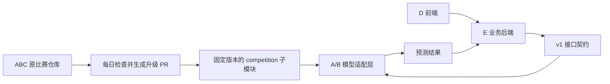

# 架构与仓库决策

## 选择

父仓库独立创建，比赛仓库以 `vendor/competition` 子模块引用。初始选择远端 `sym` 分支；任何时候可通过脚本切换远端已有分支。Gitlink 锁定完整提交，`model.lock.json` 记录同一版本，`.gitmodules` 保存后续跟踪分支。

业务层不导入训练模块，不依赖研究脚本目录。模型推理、训练环境与产品环境分别管理。默认适配器为 mock，替换真实适配器时保持同一个请求/响应结构。

## 替代方案

| 方案 | 判断 |
|---|---|
| 复制代码 | 无更新来源与版本约束，拒绝 |
| Git subtree | 交付简单，但源码并入父仓库后容易被 ABDE 修改；更新有合并成本 |
| Git worktree | 共享同一 Git 数据库；不构成独立产品仓库或可迁移依赖 |
| 版本化 Python 包/容器 + 模型服务 | 生产部署可逐步采用；目前仍需完整比赛源码，发布体系尚未建立 |
| 子模块 + 适配层 + 升级 PR | 当前采用；完整源码可追溯，研究与产品提交历史独立 |

## 更新一致性

自动更新只更改比赛子模块指针和锁文件，沿用 `.gitmodules` 当前分支。不会合并 `sym` 与 `zyb` 的代码。父仓库分支可分别固定不同模型版本，不互相影响。产品发布以父仓库提交、比赛提交、独立模型权重 SHA256 和环境清单共同标识。

CPU 检查只能证明引用完整和产品模拟接口可用。权重兼容、真实推理、效果、性能需要 A/B 在独立 GPU 环境确认后再合并。原仓库未推送的本地修改不会同步；模型权重不会随源码自动出现。
