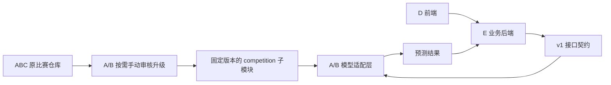
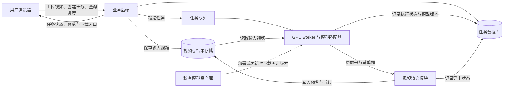

# 架构与仓库决策

产品目标、拟实现的用户流程与验收条件见[需求说明书（初稿）](requirements/README.md)。本页保留已有仓库与依赖管理决策；需求文档中的业务 v2 接口仍为草案。

## 状态与开发方向

2026-10-27 细化应用 v1.0 方向：首先面向普通用户交付网页＋云端服务，用户明确要求时提供本机服务与首次下载、持久缓存模型的可选本地模式，复用网页和业务契约。范围、阶段与验收以 [baseline应用开发计划书](baseline应用开发计划书.md) 为准，不以桌面客户端或 CLI 作为 v1.0 默认交互入口。

当前已实现仓库初始化、v1 预测及上传/任务契约、Mock 与命令适配器、本地模型资产校验，以及 SQLite 持久任务和单 worker 参考服务。参考服务将 HTTP 与 worker 暂放在同一进程，兼容页仍使用旧 Mock jobs 接口。2026-10-27 补充 CPU 媒体核心、预览/导出快照及 MP4/JSONL 参考链路；完整 F1 recipe、GPU 效果/性能验收、独立部署与业务鉴权仍待开发，本文的目标云端架构不表示已经全部实现。具体使用及边界见 [联调交接](integration.md)。

## 源码组织

父仓库独立创建，比赛仓库以 `vendor/competition` 子模块引用。初始选择远端 `sym` 分支；任何时候可通过脚本切换远端已有分支。Gitlink 锁定完整提交，`model.lock.json` 记录同一版本，`.gitmodules` 保存后续跟踪分支。

业务层不导入训练模块，不依赖研究脚本目录。模型推理、训练环境与产品环境分别管理。默认适配器为 mock，替换真实适配器时保持同一个请求/响应结构。

## 产品发布方式

| 方式 | 模型所在位置 | 适用范围与决定 |
|---|---|---|
| 安装包包含模型 | 用户设备 | 可离线，但安装包大且依赖用户硬件；不作为第一版默认方式 |
| 首次使用下载独立模型包 | 用户设备的持久目录 | 用户明确要求时的可选模式；同时准备本机服务，下载后本地运行，独立交付与验收 |
| 客户端调用云端推理 | 团队 GPU 服务器 | 第一版采用；用户无需下载权重或自备 GPU，团队承担算力、存储和带宽成本 |

当前 F1 的模型参数账本为 8,926,602,839，见子模块的 `docs/F1_FULL2D_REPRO.md`。本地运行所需显存、内存、磁盘、处理时间及支持设备须通过完整流水线实测确定。云端版需要上传视频，上传耗时和云端排队时间应在产品进度中体现。

### 云端运行架构

模型资产库可选 Hugging Face 私有模型仓库或团队私有对象存储。它负责权重归档与分发，GPU worker 负责实际推理。服务器部署或更新时取得模型并保存到持久目录；视频任务使用服务器本地模型，不在每次请求时重新下载。推理进程可复用已加载模型，具体驻留与并发策略由资源实测决定。

### 模块职责

| 模块 | 职责与边界 |
|---|---|
| `apps/frontend/` | 视频上传、比例选择、进度、预览及下载；只依赖产品接口，不持有模型仓库凭据或处理权重 |
| `apps/backend/` | 文件访问、创建和查询任务、持久化元数据、投递任务、返回预览与下载入口；不在 HTTP 请求线程中执行长时间推理 |
| `contracts/` | 定义预测及后续上传、任务状态、错误、导出接口；前后端和 worker 据此联调 |
| 任务队列与数据库 | 持久保存任务及绑定的模型发布版本，支持有限重试和重启后恢复；组件选型待实现阶段确定 |
| GPU worker | 调度推理资源、准备输入文件、调用适配器并记录执行结果；按已验证容量限制并发 |
| `services/model_adapter/` | 唯一比赛接入点；完成模型调用、命令与路径转换、结果转换和校验，隔离算法差异 |
| 视频渲染模块 | 按预测和产品导出规则执行裁剪、片段组织、编码及音轨处理，生成预览和成片 |
| 视频与结果存储 | 保存原视频、预测及导出文件，按任务关联并管理访问和保留期限；实物不进入 Git |

目标任务流程为上传完成后创建任务，再经历排队、推理、渲染和完成；执行异常应返回失败阶段及可理解的错误，不能显示为成功的空结果。当前已在 `contracts/` 固定预测任务的 queued/running/succeeded/failed/cancelled、阶段进度和错误结构，succeeded 仅代表预测完成。渲染任务、预览、下载有效期及细粒度推理进度仍需先补充契约再实现。

现有预测 v1 中的 `video_path` 在新的 uploads/tasks 接口中由服务端根据已上传文件生成，任务 video_id 等于 upload_id。浏览器只提交上传返回的标识。当前 worker 与 HTTP 服务共享本地文件目录；部署到不同机器后，worker 应先取得自己可读取的文件，再由适配器转换路径。旧兼容页仍发送固定示例路径，仅允许 Mock，不用于真实推理。

## 模型变化与接口兼容

前端依赖业务契约，不依赖模型结构、权重文件名、训练超参数或研究脚本路径。升级权重、推理参数或切换比赛分支时，由 A/B 调整资产配置、运行环境及适配器，向业务层继续输出相同含义的 v1 结果。

兼容性不仅检查字段名称，还要检查原视频帧号、坐标单位、`bboxes=[x,y,w]` 及由目标比例计算高度的语义。`engine` 标识实际模型发布版本，真实预测返回 `mock=false`。新增需要用户设置的选项或改变结果含义时，应先评审、更新接口契约，再安排客户端适配；不能以权重升级为由悄悄改变现有字段含义。

当前后端可注入适配器，也可通过 --adapter mock/command 与配置选择命令入口，已校验预测结构、请求身份和任务固定的模型版本。命令适配器需由 A/B 提供真实 runner 和完整模型资产；当前仅通过 CPU 协议夹具验证，尚未通过 F1 真推理验收。D/E 可继续用 Mock 开发；后续导出接口也应遵循先确定契约的方式。

## 模型资产与版本发布

### 存储分工

| 内容 | 保存位置 |
|---|---|
| 产品和适配器代码 | 本 Git 仓库 |
| 比赛源码 | `vendor/competition/` 子模块，以提交固定版本 |
| 权重与必要模型文件 | 经确认可托管的私有模型资产库，以及 GPU 服务器持久目录 |
| 不含凭据的版本和校验清单 | Git 中的模型发布清单；具体格式后续实现时确定 |
| 机器路径、访问 token 等部署配置 | 仓库外或被忽略的 `runtime/`，通过部署环境提供 |
| 视频、特征、预测及成片 | 仓库外存储或被忽略的运行目录 |

`model.lock.json` 继续只锁定比赛源码，不代表权重已下载、环境已准备或模型已验收。模型发布清单应另外记录产品兼容版本、比赛提交、每个组件的来源和不可变版本、文件 SHA256、推理配置及必要处理器文件、环境清单和支持的预测契约版本。HF 资产使用完整提交 SHA 固定下载版本，避免运行时跟随变化中的 `main`。

本地机器路径与可分享的版本清单分开保存。`services/model_adapter/model-assets.example.json` 为模板；已提供 `scripts/model_assets.py` 的本地逐文件 SHA256 校验和固定 HF 历史版本的两头样本清单，能拒绝 LFS 指针和不完整推理发布。尚未提供完整 F1 资产清单、自动下载或线上模型部署；complete 声明及协议校验不能替代完整算法验收。

### 发布与回退流程

1. A/B 确认目标比赛源码及完整模型组件，包括 F1 继承的主干、时间头、空间头、配置和后处理；核实已有材料中的复现缺项。
2. 整理固定版本的模型资产清单，在独立 GPU 环境准备权重并逐文件校验；不在产品开发初始化或普通 CI 中自动下载模型。
3. 从受支持的自有或授权公开视频开始跑通真实推理和视频导出，确认结果契约、失败处理、效果、资源占用及处理时间。
4. 将产品版本、比赛提交、模型资产版本和环境清单绑定为一个模型发布版本，经 A/B 确认后部署；源码同步 PR 不自动升级线上模型。
5. 新任务绑定确定的模型发布版本；进行中的任务继续使用原版本。保留上一套可用代码、配置及资产，回退时一起恢复，避免只切换权重导致不兼容。

模型交接材料已记录部分许可和用途待确认项。实际采用的托管、云端服务和权重分发方式须结合对应组件许可确认，私有存储不表示发布授权已经完成。

## 按需本地模式

本地模式由本机服务提供相同网页与契约，本机运行组件与独立模型包分别准备：先检测硬件及磁盘，首次使用下载指定模型包、展示进度并校验文件，保存到用户可配置的持久目录；后续从本地加载，具备条件时离线运行。模型包包括权重、推理配置和必要处理器文件，推理运行环境由安装或部署流程单独准备。该模式按计划书 L 阶段独立验收，不表示当前已实现。

软件声明支持的模型版本和硬件范围；模型更新经过兼容验证，保留可回退版本，不在每次视频任务中检查并自动替换模型。需要完全离线交付时可提供独立模型包，在本地导入并校验。模型包仍不进入源码 Git 仓库。本地模式复用预测契约和适配层，由后续实测决定是否需要量化或其他模型方案，不预先承诺普通电脑能够运行完整 F1。

## 源码组织的替代方案

| 方案 | 判断 |
|---|---|
| 复制代码 | 无更新来源与版本约束，拒绝 |
| Git subtree | 交付简单，但源码并入父仓库后容易被 ABDE 修改；更新有合并成本 |
| Git worktree | 共享同一 Git 数据库；不构成独立产品仓库或可迁移依赖 |
| 版本化 Python 包/容器 + 模型服务 | 后续云端运行采用独立 GPU worker 或模型服务；源码仍通过子模块管理，部署发布体系待开发 |
| 子模块 + 适配层 + 升级 PR | 当前采用；完整源码可追溯，研究与产品提交历史独立 |

## 更新一致性

2026-11-24 已移除定时比赛引用同步，产品采用固定 F1 源码快照。需要升级完整比赛引用时，由 A/B 手动更新子模块指针与锁文件，核对资产和推理兼容性后提交评审。父仓库分支可分别固定不同模型版本。产品发布以父仓库提交、比赛提交、独立模型权重 SHA256 和环境清单共同标识。

CPU 检查只能证明引用完整和产品模拟接口可用。权重兼容、真实推理、效果、性能需要 A/B 在独立 GPU 环境确认后再合并。原仓库未推送的本地修改不会同步；模型权重不会随源码自动出现。

## 开发顺序与验收

按 [baseline应用开发计划书](baseline应用开发计划书.md) 和 [分工与里程碑](team.md) 推进：先确认上传、任务及导出契约并跑通网页 Mock 闭环，再接入完整真实推理和视频渲染，最后完成资源限制、恢复、模型版本回退和云端发布验收。本地模式在用户要求时按 L 阶段交付，不与云端完成状态混淆。

相关能力文档：[接口契约](../contracts/README.md)、[适配器边界](../services/model_adapter/README.md)、[HF 固定版本下载](https://huggingface.co/docs/huggingface_hub/guides/download)、[HF 下载缓存](https://huggingface.co/docs/huggingface_hub/guides/manage-cache)。外部平台的具体容量和费用在部署选型时确认，本文不固定套餐或预算。
