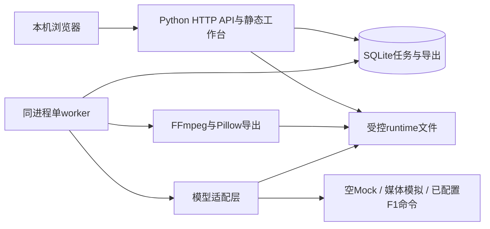
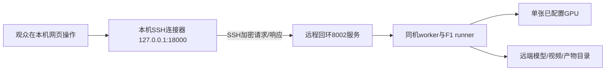

# 架构与仓库决策

更新：2026-11-25。以大学生课程示例规模交付，当前能力见[状态页](STATUS_20261125.md)，本轮范围与负责人见[最终改进计划](FINAL_IMPROVEMENTS_PLAN_20261125.md)。本次修订描述已有架构与待改进边界，不声称已经实施新的部署系统。

## 当前实际架构

HTTP线程处理上传/查询，worker串行领取预测和导出任务；长时间推理不在HTTP请求线程执行。不同runtime有独立文件与锁，同一runtime只允许一个worker。SQLite持久保存任务、幂等键、结果和导出快照；启动时将遗留running标为失败供显式重试，不具备中断续算。

网页使用uploads/tasks/preview/exports v1，旧jobs只保留Mock API兼容。浏览器保存最近任务摘要与已应用编辑，服务端没有Project或EditRevision完整业务模型。预测succeeded只代表预测完成，成片有独立导出状态。运行中预测不能由用户取消；排队预测可取消，导出取消接口尚无。

## 远程真实演示

演示者开通已有GPU实例并运行connect_demo.py；连接器调用远端启动脚本，浏览器不持有密码。此模式已提供，不能再写为“云端完全未接入”；同时它不是通用公网多用户入口。一次SSH连接串行转发HTTP，需保持连接器运行。现有服务无业务鉴权，保持回环/受信任演示，不直接开放匿名公网。

本机真实推理在配置相同资产与支持的GPU环境后也可部署，但首次下载/设备检测/缓存管理器未实现。本轮不把这些扩展、账户隔离、对象存储或微服务作为交付条件。

## 模块职责

| 路径 | 当前职责 |
|---|---|
| apps/frontend | 中文单视频工作台、模式说明、上传/状态、片段编辑、裁剪预览、下载 |
| apps/backend | 标准库HTTP服务、静态资源白名单、上传/任务/预览/导出端点 |
| services/task_service | SQLite、单worker领取/恢复、幂等、模型身份绑定、排队取消 |
| services/media | CFR/VFR 元数据与源SHA、边界检查、片段与实际整数框、MP4/JSONL导出、Range；VFR 精确时间映射暂缓 |
| services/model_adapter | 唯一比赛接入边界，完整资产校验、命令runner、四阶段F1新视频推理 |
| contracts | 已实现的v1请求/响应、预览、导出和部署状态契约 |
| scripts | 初始化/检查、按需引用更新、演示连接器和SSH传输；本轮拟补启动/维护工具 |

当前媒体规则consecutive-inward-v1只合并连续选帧，不暗中补帧/平滑；用户扩展建议区间时使用该建议边界框。模型结果不被编辑覆盖，导出绑定固定plan快照。修改这些语义需独立版本和媒体验证。

## 源码、模型与验收

产品代码独立于研究仓库。vendor/competition以model.lock.json固定sym提交4cfe928；references/competition-f1提供来自正式交付的固定129项源码/配置参考，f1_stage通过校验后在独立runner使用它，不由业务层直接导入训练工程。A/B当前不再训练，固定源码与模型本轮不升级。

真实f1-derived-video-v0已实现特征提取、选帧、裁剪和结果组装，50项资产清单与固定源码逐项SHA校验。11月5日4090、11月6日4090D的12秒样片已有双画幅、编辑、音频MP4与下载记录；显存采样约19.2GB，独立推理71～87秒。只支持该条件下的链路证据，不保证所有素材效果/速度，也不是逐字节复现旧比赛提交。

原f1-expected-assets.json和hf-legacy-ybox3.json仍保留旧槽位/部分小头历史审计。完整新视频候选依据f1-downloaded-assets.json（50项）、f1_setup.py、f1_stage.py与实际部署清单；仓库候选complete=false不自动批准生产发布。部署经过GPU验收后使用独立完整发布配置，不能把complete字段手工改true冒充验收。

## 资源与版本管理

| 内容 | 位置 |
|---|---|
| 产品代码、v1契约、非敏感清单 | 本仓库 |
| 固定研究源码 | references/competition-f1及锁定比赛子模块 |
| 权重/processor | 经SHA验证的服务器或本机仓库外资产目录 |
| 机器路径与部署配置 | 仓库外或忽略的runtime |
| 视频、特征、预测、成片、凭据 | 仓库外/忽略目录；凭据不进入文档或提交 |

2026-11-24已移除定时比赛引用同步。升级仅由A/B按需手动评审，代码、配置、资产一起绑定；当前没有自动升级PR或线上自动替换。HF可以作为可选模型来源，不提供本项目默认算力，也不会在每次任务时重新下载权重。

## 本轮架构决定

保留原生前端、Python、SQLite、单worker与已有SSH演示链路。B降低启动门槛，D收敛模式入口，A完善媒体体验/验证，E处理运行目录维护与失败恢复。优先解决能实际复现的阻断问题；常驻模型、拆分渲染worker等性能改造只在测量证明必要且排期允许时作为P1。

公网多租户、完整业务v2、可选本机模型安装器及分布式架构留作扩展设计。若未来使用范围改变，再定义对应访问边界与发布标准，不将其纳入本轮课程完成条件。
