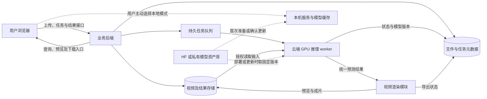

# Highlight Studio baseline 应用开发计划书

版本：应用 v1.0 开发基线。更新日期：2026-10-27。适用成员：A/B/D/E；C 继续在原比赛仓库维护算法与训练。

## 1. 产品目标与开发依据

v1.0 首先交付一个可通过浏览器使用的视频高光剪辑网页。默认由云端服务完成模型推理与视频处理，用户完成“上传视频 → 选择画幅 → 等待分析 → 预览高光 → 导出结果或成片”，无需准备 HF 凭据、Python 或 GPU。

用户明确要求本地处理时，提供同一网页交互下的可选本地模式：首次准备本机运行环境并下载指定模型包，校验后持久缓存，后续本地加载。云端网页是默认交付；本地模式单独实现和验收，未完成时不得展示可用入口或宣称已支持。

本计划是后续 v1.0 功能范围、实现顺序和交付验收的执行基线，依据以下材料制定：

- [需求分析文档-初步](需求分析文档-初步.md)：保留用户场景、F-01～F-16、P/T 指标及 AC 用例作为需求来源。
- [软件设计文档-初步](软件设计文档-初步.md)：保留算法模块、数据语义、异常处理及可替换模型的设计依据。
- [架构与发布设计](architecture.md)、[联调交接](integration.md)及 [v1 接口契约](../contracts/README.md)：衔接当前工作区已有代码和接口。

两份初稿中的“CLI 为主入口、仅本地离线、GUI 封装 CLI、默认不提供云端服务”按本计划调整。其余需求按第 3 节追溯，不把初稿中的全部扩展能力视为 baseline 已完成。实现请求和响应仍以 `contracts/` 为准；新增或不兼容功能应先补充、评审契约，再实现，不能只修改本文就改变已发布接口。

## 2. 产品形态与初稿差异

| 初稿中的描述 | v1.0 落地方式 |
|---|---|
| CLI + 本地 Web GUI 为主 | 网页为普通用户主入口；CLI 保留为开发、部署和复现工具，不要求用户执行命令 |
| 浏览器选择输入、输出的本机路径 | 浏览器选择文件并上传，使用文件和任务标识；结果通过受控下载入口取得，不暴露服务器路径 |
| 模型权重默认由每个用户本地准备 | 默认由 A/B 在云端准备；用户仅在主动选择本地模式时下载模型 |
| 单机离线，无公网调用 | 云端模式允许向已部署的处理服务上传用户选择的视频；本地模式完成准备后按离线能力实测验收 |
| JSONL 为主产物，预览/成片可选 | baseline 网页必须完成可播放预览、JSONL 导出及至少一种 MP4 成片导出的闭环 |
| GUI 直接展示模型路径与训练参数 | 普通用户只选择视频、目标比例及产品导出选项；模型路径、采样和推理参数由受控配置管理 |
| 所有异常只使用初稿的 E_* 错误码 | 保留现有 API 机器错误码；新增异常先定义契约。需要展示 E_* 分类时建立映射，不直接重命名已有错误码 |
| 不提供云端协作和账号体系 | 仍不开发多人协同编辑、计费和公开分享；对外服务须具备最小访问身份及任务/文件隔离 |

网页端核心流程优先支持单视频；多视频通过多个独立任务逐步扩展，异常视频不应阻断其他任务。v1.0 默认目标比例为 16:9 和 9:16；其他比例即使底层参数能通过结构校验，也须经过模型与渲染验证才在界面开放。

## 3. 功能范围与需求追溯

P0 为云端网页 baseline 发布必需；P1 为核心闭环完成后的增强；L 为用户明确要求时交付并独立验收的本地模式。P1 和未启用的 L 不阻塞云端 baseline，但不得作为已完成功能对外展示。

| 初稿需求 | 本计划的具体交付 | 优先级与边界 |
|---|---|---|
| F-01、F-10 | 网页文件选择/拖拽、上传校验、任务创建；导入结果和错误可见 | P0 单视频；P1 多文件与 JSONL 批量导入。浏览器不解析服务器本机路径 |
| F-02 | 云端解码、元数据检查、采样及原视频帧号映射 | P0 采用选定模型已验证的固定流水线；智能采样新路线为 P1 |
| F-03、F-04 | 实际模型输出高光帧与推荐构图框，记录具体模型发布版本 | P0；Mock、继承的比赛预测文件或测试夹具不能代替新视频真实推理 |
| F-05 | DPO/GRPO 等训练与偏好优化 | 算法研究范围，在原比赛仓库进行，不纳入网页运行时 |
| F-06、F-07 | 原视频帧号、旋转与坐标语义一致，框边界和数值校验，失败可追溯 | P0；模型相关修正仅放在算法/适配边界，不由前端私自修补 |
| F-08 | 下载标准 JSONL，每行仅含 video_id 与 predictions | P0；与产品 API 的 engine/mock 等封装字段区分 |
| F-09、F-13 | 浏览器播放、时间轴高光、推荐框叠加及目标比例预览 | P0；预览失败不损坏已完成的预测和 JSONL |
| F-09、F-14 | 按固定规则生成 MP4，网页显示渲染状态并下载成片 | P0 自动片段方案和固定编码预设；P1 勾选、排序、时长微调及更多编码选项 |
| F-11 | 比例和已开放导出配置即时校验，保存任务配置快照 | P0；完整高级参数面板及 all_frames 为 P1，不能直接把额外参数塞入现有严格 v1 请求 |
| F-12 | 排队/推理状态、错误、失败后新任务重试、页面刷新恢复 | P0；当前仅排队任务可取消。运行中取消、批量控制及更细粒度恢复先补契约，再作为 P1 实现 |
| F-15 | 任务级错误说明、处理建议和可复制诊断标识 | P0；P1 日志筛选、批量报告与统计。用户不直接读取服务器文件或原始凭据日志 |
| F-16 | 简明使用引导、当前运行模式和模型版本说明 | P0 最小信息；P1 完整设置页、多语言和界面个性化 |
| 本次产品形态补充 | 用户选择本地运行、首次下载/导入模型、持久缓存、本机推理 | L；同一网页能力和契约，不另做一套桌面交互产品 |

v1.0 不包含直播实时剪辑、多人协同时间线、自动字幕、卡点音乐、专业调色、VR/360°、多机位同步或默认浏览器内直接运行 8B 级模型。原“4K、4 小时视频”和复杂音频语义理解须按实际推理链与资源测量确认，不因初稿列出就宣称支持。

## 4. 目标架构与部署方式

### 4.1 云端默认模式

第一阶段采用一个业务后端加一个可独立部署的 GPU worker，按需增加渲染进程，不先建设复杂微服务平台。现有 SQLite 持久队列与单 worker 是联调参考实现；若改为独立机器或多 worker，E 先确定任务领取、恢复和共享存储方案，再升级实现，不直接把当前同机路径用于远程推理。

部署可以选择团队 GPU 服务器，或经验证能够运行完整流水线的 HF 计算服务。D 的网页只访问产品 API，业务后端/适配层屏蔽算力供应方与模型版本变化。对外发布需要 HTTPS、最小访问身份、任务/文件访问校验和资源限制；当前本机参考 HTTP 服务不直接作为公网生产服务。

### 4.2 HF 权重托管与 HF 推理服务分开管理

- **模型资产库**：已知仓库为 [aicsym/aic_weights](https://huggingface.co/aicsym/aic_weights)，用于固定版本的权重、配置和必要处理器文件归档、分发。将文件上传至 Hub 本身不能视为完整 F1 服务已部署。
- **推理运行环境**：GPU、Python/容器、真实 runner、前后处理及服务适配共同执行推理。若选择 HF 提供算力，应单独验证计算服务与完整自定义流水线的兼容性；可参考 [HF 自定义容器部署](https://huggingface.co/docs/inference-endpoints/guides/custom_container)，不假设标准托管接口会自动识别本仓库的研究脚本。
- **运行方式**：部署/升级时取得确定版本并校验，任务复用运行环境中的本地权重；不在每个视频任务中从 HF 重新下载模型。
- **访问边界**：HF 凭据保留在资产准备和部署环境。浏览器不携带团队共享的 HF token，也不直接调用模型仓库来完成视频推理。

### 4.3 用户按需选择本地模式

本地模式仍使用网页交互，但需要安装或启动本机推理服务。普通网页不能仅靠下载文件就获得 Python/CUDA 环境和任意本机路径访问能力。优先由本机服务提供同一套网页与 v1 API，避免另写一套 UI；如从云端网页连接本机服务，应先验证浏览器权限、跨源和连接方案。

流程为“用户明确选择本地 → 检查支持系统、GPU/内存/磁盘 → 说明模型大小和版本 → 首次下载或离线导入 → SHA256 校验 → 持久缓存 → 本机推理/渲染”。后续使用本地缓存，只在用户确认模型更新时取得新组件。下载中断可恢复、未完成文件不得加载，提供缓存位置、清理和失败重试说明。

本地模式不上传输入视频到云端；首次准备及模型更新可能联网，模型、运行依赖准备齐全后的离线能力须单独验证。设备不满足要求时明确提示，可由用户选择云端，不宣称所有普通电脑或 CPU 都能运行完整 F1。可分发组件、硬件要求、安装包与模型包分别记录和验收。

## 5. 模块分工与资源准备

| 成员/模块 | 开发工作与交付物 | 需要准备的资源 |
|---|---|---|
| A：架构、契约、模型发布 | 需求映射、接口评审、版本清单、发布/回退记录、集成验收 | 产品与比赛源码读取权限；不要求 D/E 直接使用训练工程 |
| B：模型集成 | 补齐真实 runner 和模型组件、元数据/框语义验证、GPU 性能记录、按需本机适配 | GPU 环境、完整真实权重、推理配置与处理器；直接取私有 HF 文件时需要读取权限 |
| D：网页 | 上传/配置、任务状态、预览、导出、错误与模式说明；通过 API 工作 | 产品源码、契约及 Mock 服务；无需 HF、SSH、GPU 或训练特征 |
| E：业务后端与导出 | 文件与任务管理、受控访问、持久队列、渲染和结果存储，向网页提供稳定接口 | 开发数据库/存储和 Mock；真实联调时取得推理服务或 worker 接口，部署负责人另管理主机凭据 |
| C：比赛算法 | 原仓库内的研究、训练及必要算法修正 | 原比赛环境与训练资源；不参与产品业务代码开发 |

模型训练不在本产品初始化或普通 CI 中进行。权重、视频、特征、预测实物及凭据不入产品 Git；原比赛子模块不直接改文件、提交或推送。D/E 可以先完成 Mock 联调，不等待 HF 更新或 GPU 主机准备。

## 6. 当前基础与接口演进

以下为当前工作区已有参考实现，不能等同于已发布的网页产品；真实部署和交付状态须另行记录。

| 能力/接口 | 当前状态 | v1.0 后续工作 |
|---|---|---|
| `POST /api/v1/uploads` | 原始字节上传，返回标识、大小和 SHA256；默认上限 512 MiB | 加入业务归属、真实元数据检查和存储保留规则；扩容/分片上传先评审契约 |
| `POST /api/v1/tasks` | 返回 202，支持 Idempotency-Key | 对接正式业务任务及远程 worker，保留幂等与模型固定语义 |
| `GET /api/v1/tasks/{id}` | 持久状态与阶段；推理中 percent=null | 网页轮询和刷新恢复；未有真实进度时展示阶段，不伪造百分比 |
| `GET /api/v1/tasks/{id}/result` | 成功后返回统一 v1 预测 | 提供基于同一结果的预览、JSONL 与成片导出 |
| `POST /api/v1/tasks/{id}/cancel` | 仅排队任务可取消 | 界面按状态显示操作；运行中取消需独立实现和验收 |
| `GET /api/v1/model`、`/health`、`/ready` | 模型/Mock 信息、存活与就绪检查 | 运维与界面显示；就绪检查不替代真实模型验收 |
| 命令适配器与资产校验 | 有统一请求/结果文件协议，可拒绝 LFS 指针及哈希不符 | 提供真实 runner、完整资产和独立环境，完成 GPU 验收 |
| 当前首页与 `/api/v1/jobs` | 旧 Mock 兼容入口 | D 开发正式网页并使用 uploads/tasks；旧入口不当作成品 |
| 片段、预览、渲染及文件下载 | 尚未实现产品闭环 | E 与 A/B 先冻结契约，D 使用对应 Mock 并行开发 |
| 首次下载模型的本地模式 | 尚未实现 | 按第 4.3 节独立交付，不能用已有权重文件夹代替安装和使用流程 |

预测请求与响应继续使用 `contracts/` 的 v1 Schema。产品字段为 target_ratio；初稿/比赛中的 targetRatioWH 等字段只在适配层转换。原视频帧号、源像素 `[x,y,w]`、高度推导和 video_id 一致性保持不变。

现有任务的 succeeded 表示预测完成，不表示成片完成。导出采用独立任务/资源，创建、状态、失败、预览及下载接口均先写入 `contracts/`；不得为方便 UI 直接向现有严格任务 Schema 增加 rendering 等枚举或字段。选择 API v1 的兼容新增或 v2，均应先完成契约评审。

JSONL 下载时序列化为 `{video_id,predictions}`；产品 API 中的 engine、mock、任务状态等信息保留在产品元数据，不擅自混入比赛/算法输出格式。

## 7. 高光结果到网页成片的规则

模型输出的是可能稀疏、非连续的帧号与构图框，不能直接当作已定义好的视频片段。E 与 A/B 在渲染开发前共同固定以下规则并记录版本：

1. 按原视频显示帧/时间戳将相邻高光聚合成片段，确定间隔阈值、前后缓冲、最短/最长片段长度、重叠合并与去重策略；边界限制在原视频内。
2. 未预测帧的构图轨迹采用明确的插值或保持策略，坐标基于显示分辨率，正确处理旋转；可变帧率使用解码时间戳，不能无条件用 frame/fps 代替。
3. baseline 提供一套可复现的 MP4 编码、分辨率、帧率及音频预设；有音频时保持片段与音轨同步，无音频时正常导出，不自动加背景音乐。
4. 预览、用户选择及渲染结果引用确定的预测版本与渲染规则。预览比例切换不修改原预测；需要不同模型比例时创建独立任务。
5. 合法空预测展示“未检测到高光”，JSONL 仍可下载；不伪造高光或生成损坏的空成片。渲染失败只使导出失败，保留已成功预测以便重试。

初轮采用自有或授权的 1～10 分钟、1080p/30fps 样例完成闭环，同时验证 16:9 与 9:16；这只是开发样例范围。发布支持的格式、分辨率、时长、大小和并发须在实际环境测量后写入配置与用户说明，超过范围即时提示，原文的 4K/4 小时支持不作为未经实测的发布声明。

## 8. 模型资产与发布管理

产品版本、比赛提交、模型发布版本、每个组件的 SHA256、必要处理器/推理配置、环境版本及契约版本共同构成可追溯发布。HF 下载使用完整提交 SHA 固定版本，后端或本机服务缓存实物；源码同步不自动升级线上模型，升级前排空或保留旧任务使用的版本，回退恢复同一套代码、配置和资产。

当前 HF 历史清单固定 `aicsym/aic_weights` 的 `f0cfb12f0b11255a4dac89cb463e63b5c53527da`，只列了两个已核验旧 ybox3 小头及配置，complete=false；它不包含完整 F1 发布。`E:/aic_weights` 是指针克隆，`E:/aic_weights_audit` 是本地审计和样本目录；不能将这些机器路径当作其他成员或生产环境的资源保证。

A/B 需补齐 F1 所继承的主干、时间头、空间头、二维头、配置、处理器和后处理，确认真实原视频到预测可运行。若先发布其他已验证 baseline，必须明确其实际模型版本与限制，不能标称为 F1 或承诺复现最高分。模型/数据用途及托管、分发许可的已知待确认项在对应发布前解决。

## 9. 分阶段开发与里程碑

以下按完成条件推进，不以文档中的历史截止时间或假定 GPU 就绪日期承诺交付时间。A/B/D/E 每轮同步已完成、证据、阻塞资源及下一步；开发可并行，验收门槛不跳过。

| 阶段 | 负责人 | 工作与交付物 | 依赖和完成条件 |
|---|---|---|---|
| M0：锁定 baseline | A/B/D/E | 确认本计划、现有上传/预测契约及待新增片段、预览、导出契约；提供 Mock 数据与错误样例 | D/E 能基于契约开发；明确哪些接口已实现、哪些仍为设计 |
| M1：网页＋Mock 闭环 | D/E，A/B 支持 | 网页上传、比例选择、任务阶段、错误/重试、刷新恢复；预览和导出先按明确 Mock 契约联调 | 无需 HF/GPU 可演示；Mock 标记可见；新页面不依赖旧 jobs 或服务器路径 |
| M2：真实模型接入 | A/B，E 配合，可与 M1 并行 | 完整资产清单、独立环境、真实 runner、原帧号/框边界验证、固定样例 GPU 记录 | 需要可用算力及完整组件；从新输入视频真实生成结果，mock=false；记录效果和资源限制 |
| M3：真实预览与导出 | E/D，A/B 配合 | 固定片段与渲染规则、网页预览/叠框、JSONL 下载、异步 MP4 渲染与下载、导出失败重试 | 使用 M2 实际结果，完整上传到可播放成片通过；已有预测不被导出操作隐式修改 |
| M4：云端 baseline 发布 | A/E 部署，ABDE 验收 | 正式部署、访问隔离、容量/并发/超时限制、模型版本回退、浏览器与异常测试、部署和演示说明 | 第 10 节云端必测项通过；接口、资源参数和限制与实测一致 |
| L1：按需本地交付 | B/E/D，A 验收 | 设备检查、本机服务、首次下载/导入、持久缓存、模型更新/回退、本机预览及导出 | 用户明确要求时启用；单独验证首次联网准备和后续离线流程；不满足硬件时不冒充成功 |

建议任务拆分：A 负责契约/发布版本，B 负责真实 runner/资产/本机运行，D 先完成网页 G1～G4 的核心交互，E 先完成上传与任务业务化、片段/预览/导出接口。完成 M1 不代表 M2～M4 已完成，完成云端发布也不代表 L1 已交付。

## 10. 验证与验收标准

| 用例 | 必须观察到的结果 | 来源 |
|---|---|---|
| W-01 网页全流程 | 普通用户无需 CLI/HF/SSH，从上传到预览、下载 JSONL 和 MP4 完成；至少两种目标比例 | F-01、F-08～F-14；AC-16/18/19 |
| W-02 真实推理 | 运行实际指定模型，输出对应新视频、固定模型版本且 mock=false；Mock 和历史预测不能通过此验收 | F-02～F-04；AC-01/12 |
| W-03 格式与语义 | 原视频显示帧号正确且唯一递增，框有限且合法，JSONL 可解析；旋转、无音频和异常样例有明确结果 | F-06～F-08；AC-03～AC-10 |
| W-04 任务可靠性 | 重复网络提交不重复执行；刷新后可恢复查询；排队取消有效；中断和缺模型报错，不转成成功空预测 | F-12、F-15；AC-14/21 |
| W-05 渲染正确性 | 片段聚合/裁剪与版本规则一致，成片可播放、音画同步；渲染失败不破坏预测或 JSONL | F-09、F-13、F-14；AC-15/18/19 |
| W-06 空结果与错误 | 空预测、解码失败、超时、OOM、上传超限、权限不足、模型未配置分别显示原因及可执行建议 | F-07、F-15；AC-05～AC-10/13/20 |
| W-07 云端访问与资源 | 非所属任务/文件不可读取，模型凭据和内部路径不泄露；并发、文件大小、保留及超时规则实际生效 | 云端形态新增，替代“所有数据绝不联网”的旧运行假设 |
| W-08 发布可复现 | 锁定代码/模型/配置/环境，部署说明可复现，模型升级与回退可验证，记录实际算力及处理时间 | 初稿可维护性及可复现性要求 |
| L-01 首次本地准备 | 明确选择模式、设备检查、展示实际下载大小、下载/导入校验；中断可恢复，LFS 指针和半文件不可加载 | 本次按需本地要求 |
| L-02 后续本地运行 | 复用持久缓存，视频不上传云端；准备齐全后断网仍可完成支持范围内的推理/导出；更新与回退兼容 | 本次按需本地要求 |

网页状态建议 1～2 秒轮询，运行阶段无真实百分比时显示等待和阶段。原 P-09～P-11、T-07～T-09 的本机时延目标须补充网络、缓存和设备条件后评估；API 响应、上传、排队、模型推理和渲染分别计时，不把公网传输时间算成模型性能。

原 P-01～P-08 的算法/资源目标作为待测目标保留，按固定 GPU、模型、视频和配置记录结果；原文出现的 v1.3 指标标签不代表本计划已升级应用版本。偏差应书面说明并确认验收基线，不能声称已经达标。比赛 F1 的历史 43.37 分不直接作为任意用户视频的质量保证。

现有 `scripts/smoke.py` 和 `tests/` 用于 CPU 接口及合成媒体渲染回归，实际 GPU、浏览器、真实结果渲染及 L 模式另行验证。样例使用自有或授权素材；保持比赛数据的原有使用边界。

## 11. 开发执行与完成定义

1. 后续功能开发先阅读本计划、`contracts/` 和 [联调交接](integration.md)，按对应 M/L 阶段拆分任务；PR/交接说明列明关联需求、接口变化、完成条件和验证证据。
2. 同一任务协议贯穿 Mock、云端和按需本地实现；模型或权重变化通过适配层消化。新增用户功能先更新契约、Mock 与调用说明，D/E 不猜测字段。
3. 对外可用功能至少包含实现、契约、失败处理、必要验证和使用说明；不能只提交截图、空按钮或接口占位并标记完成。
4. 需求、部署模式或优先级变化先更新本计划及关联文档；已发布的接口按兼容规则演进。两份初稿保留作为来源，不以其旧单机离线条款否定本计划的网页云端方向。
5. 本次建立计划与开发入口，不代表新增网页、云端部署、真实模型或本地下载功能已经完成。后续进度在 [团队分工与里程碑](team.md) 中按实际证据更新。

## 12. 2026-10-27 无 GPU 开发进度

按本计划已补齐 A/B 的 CPU 前期核心：媒体契约、片段/裁剪规则、原视频语义检查、预览与不可变导出快照、CPU MP4/JSONL、F1 资产审计和 runner 编排准备。详见 [A/B CPU 开发交接](ab-cpu-preparation.md)。严格连续选帧、半开区间、无隐式补帧/平滑、按同源时间剪原声的默认规则与新增需求 BR-01～BR-06 对齐。

此进度不改动两份初稿，也不代表网页、完整业务 v2 或真实 F1 已完成。需求草案中扩展的编辑版本、项目生命周期和业务 v2，由 D/E 在后续计划中实现；当前编辑核心只提供快照/预览与导出参数，不充当完整项目管理。M2 的真实新视频推理和 M3/M4 验收仍保留原完成标准。
