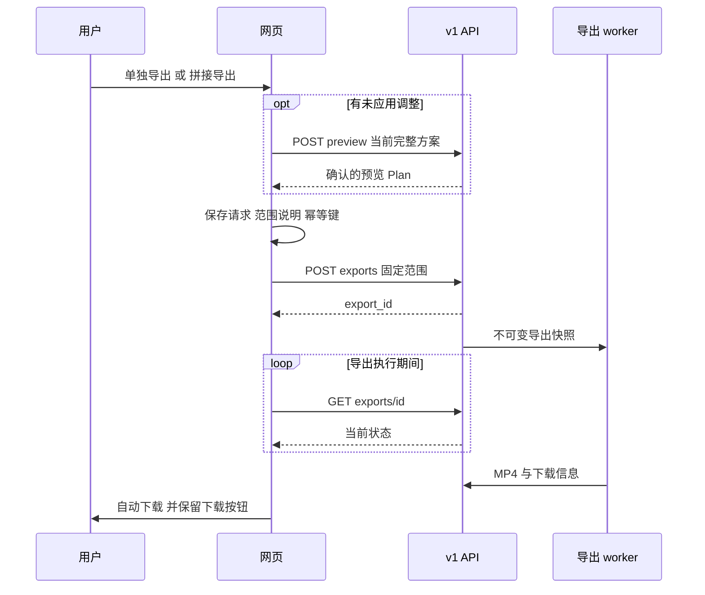

# 单个高光独立导出与多段拼接

状态：初稿，随功能 PR 评审。日期：2026-11-26。

用户可以直接下载某一个高光，或勾选多个高光后一键拼接成 MP4。实现复用现有 v1 导出接口和渲染器，不重新分析视频，不修改比赛模型或预测结果。

## 1. 使用方式

| 用户操作 | 导出范围 |
|---|---|
| 点击片段旁「单独导出」 | 该片段当前起止范围，始终生成 MP4；不受该段是否勾选影响，也不改变其他勾选 |
| 勾选多个片段，点击「拼接导出已选片段」 | 按原视频顺序拼接所有勾选范围，跳过未选区间 |
| 调整起止时间后直接导出 | 先校验、应用当前调整，再生成导出快照，无需先手动点击应用 |
| 文件生成完成 | 自动下载一次，并保留明确标注片段范围的下载按钮 |
| 刷新后恢复已有导出 | 查询真实状态并恢复下载按钮，不在打开历史任务时自动下载 |

未勾选任何片段时，拼接 MP4 按钮不可用；单段按钮仍可用。JSONL 导出保留原功能，可以导出空选集。单段按钮始终输出 MP4，不受右侧 JSONL 选项影响。

每次仅为当前预测生成一份导出。创建请求未确认或生成过程中，编辑、格式和其他导出按钮会锁定，避免用户修改正在生成的快照；成功或明确失败后解锁。

## 2. 接口与范围

单段与多段均使用 `POST /api/v1/exports`，轮询 `GET /api/v1/exports/{id}`，成功后访问返回的文件 URL。现有 `segments` 已能表达所需范围，因此没有增加 API 或改变 Schema。

单独导出第二段的示例：

```json
{
  "api_version": "1",
  "task_id": "22222222222222222222222222222222",
  "format": "mp4",
  "segments": [
    {"suggestion_id": "1", "start_frame": 20, "end_frame_exclusive": 25, "enabled": true}
  ]
}
```

多段拼接提交完整当前方案，保留各段合法、按源顺序的帧区间，将未选片段标为 `enabled=false`。服务端从该请求创建独立 Plan/Export 快照，按既有 `consecutive-inward-v1` 规则生成画面及原声音轨，忽略未选范围。每份导出有独立 export_id、plan_id 和文件，不会覆盖先前导出或模型结果。

## 3. 前端实现

`apps/frontend/app.js` 新增每段导出入口，并扩展现有导出流程：

1. 读取当前选择及起止时间，校验越界、重叠和空区间。
2. 如有未应用调整，先通过预览接口取得服务端确认的方案。
3. 固定导出请求和上下文，保存幂等键后创建导出。
4. 轮询时显示「高光 02」或「已选 2 段高光」等范围说明。
5. 成功后使用素材名及范围生成下载文件名，触发一次下载；浏览器若阻止自动下载，用户可点击保留的按钮。

单段请求只复制目标片段并强制启用该副本，不修改拼接选择。`saveEdits` 由预览按钮和导出共用，避免两套边界处理。`exportContext` 与 `pendingExport` 保存在浏览器恢复记录中，只作为用户提示和重试依据，实际状态仍向服务器查询。



## 4. 重试与任务隔离

- **创建响应丢失：** 浏览器保留原请求、上下文和幂等键，显示「重试上次导出」。刷新后仍复用它们，不把单段导出换成当前勾选的多段，也不创建重复文件。
- **已接受但渲染失败：** 清除自动下载意图，允许重新发起新的快照和幂等键。
- **历史恢复：** 自动下载标记仅保存在本次页面运行状态中。刷新和查看历史不会反复下载，已有文件仍可手动获取。
- **切换任务：** 创建响应与轮询均核对页面代次，轮询额外核对 export_id，防止旧请求更新新任务的下载入口。

## 5. 验证

### 浏览器与不依赖媒体工具的检查

Windows、Python 3.13.9、Node.js、Edge/Playwright：

- `python scripts/check_repository.py`、`python scripts/smoke.py`、JavaScript 语法检查通过。
- 39 项定向 Python 测试通过，覆盖已有任务、中继、媒体准入、Schema 和 Plan 规则。
- `tests/frontend-segment-export.cjs` 通过：未勾选片段独立 MP4、修改边界的非相邻多段导出、自动下载、生成期间锁定、非法范围不提交、单段忽略 JSONL 选项、响应丢失与刷新幂等恢复、失败后新快照及 390 像素布局。
- `frontend.cjs`、`frontend-playback.cjs`、`frontend-recovery.cjs`、`preview-layout.cjs` 回归通过。

片段导出浏览器测试自建本机 HTTP 服务，下载内容是明确的 API 请求回执，验证请求范围和下载行为，不以该夹具冒充实际编码的 MP4。

```powershell
# 安装本机 Playwright 与 Edge，或按前端 README 指定 PLAYWRIGHT_MODULE
node tests/frontend-segment-export.cjs
```

### 实际 CPU 成片验证

新增 `tests.test_media.MediaTests.test_individual_and_combined_exports_keep_distinct_video_audio_snapshots`，在具备 FFmpeg/FFprobe 和开发依赖的环境执行：

- 通过真实导出队列生成第二段独立文件及两段拼接文件。
- 检查独立文件为 5 帧/0.5 秒、拼接文件为 10 帧/1 秒。
- 解码实际文件检查蓝色单段、红色后接蓝色的顺序和尺寸。
- 从实际 AAC 音轨检查单段的 880 Hz，以及拼接前后 440/880 Hz 音调，确认没有带入未选间隔。
- 核对 export_id/plan_id 不同、预测和源文件保持不变。

```sh
python -m pip install -r requirements-dev.txt
python -m unittest tests.test_media.MediaTests.test_individual_and_combined_exports_keep_distinct_video_audio_snapshots -v
```

全量 CPU 回归由 PR 的 Product checks 执行，结果以对应提交的 Checks 为准。本次没有执行模型训练、下载权重或重新跑 GPU 推理。

## 6. 保留的边界

拼接使用原视频顺序，不提供拖动重排、转场或多素材混剪。沿用既有比例、裁剪和音频规则；此前按用户要求暂缓的 VFR 精确时间映射与音画同步不在本功能中补齐。浏览器记录最新一份导出，旧导出文件仍由服务保存，但本次不新增完整导出历史列表。
