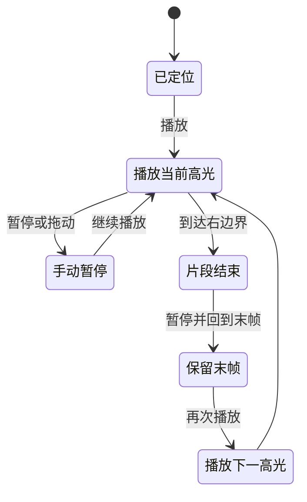
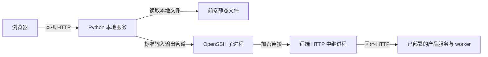

# 视频预览与媒体导入改进技术说明

状态：初稿，随 PR 评审。整理日期：2026-11-26。功能来自 11 月 6 日的演示改进，本次整理提交到最新主分支。

本次修复裁剪预览越过高光终点后出现空画面的问题，增加可拖动播放指针，并按产品要求取消固定帧率准入限制。同批提交还保留已完成的保存服务器连接、完整画面显示、失败后重新导入和简化页面文案。模型及权重沿用现有版本。

## 1. 问题与结果

| 问题 | 原因 | 改动后的行为 |
|---|---|---|
| 裁剪预览播放到高光之外出现空画面 | 原片播放器持续前进，而 `cropMap` 只包含已选高光帧 | 每段结束暂停并定位到最后一个有效裁剪帧，再次播放进入下一段 |
| 时间轴没有当前播放位置 | 只有高光块和数字时间，没有时间轴指针 | 竖线随播放移动，支持拖动和键盘逐帧定位 |
| 正常可解码的视频被拒绝 | 预检查强制要求第 i 帧时间戳等于 i/fps | CFR/VFR 均可通过媒体准入；VFR 暂用平均帧率时钟 |
| 大分辨率视频预览被截断 | 网格子元素的固有尺寸将媒体元素撑出容器 | 限定网格轨道及媒体边界，以 `object-fit: contain` 完整显示 |
| 失败后不能重新选择素材 | 输入锁定条件只判断存在任务，没有区分任务终态 | 失败或取消后解锁，重新导入时清除旧任务绑定，历史记录保留 |
| 每次启动需要输入 GPU 地址 | 连接参数仅由命令行传入 | 保存非敏感连接参数，复用本机 OpenSSH 认证 |
| 页面包含难理解的内部术语 | 直接展示引擎、机器地址及错误码 | 使用中文状态说明；API 继续保留真实 engine/mock 信息 |

## 2. 文件与模块

| 文件 | 职责 |
|---|---|
| `apps/frontend/app.js` | 播放位置、片段暂停、输入锁定与用户文案 |
| `apps/frontend/index.html` | 时间轴指针结构、可访问标签与页面说明 |
| `apps/frontend/styles.css` | 竖线、拖动区域、焦点及完整画面布局 |
| `services/media/probe.py` | 解码检查及 CFR/VFR 元数据生成 |
| `contracts/media-metadata.schema.json` | v1 元数据枚举扩展 |
| `config/demo.json` | 默认服务器与本地端口，不含认证秘密 |
| `scripts/start_demo.py` | 本地网页与 SSH 中继启动、连接校验和进程清理 |
| `Start-Demo.cmd`、`Start-Demo.ps1` | Windows 启动入口及就绪检查 |
| `tests/` | 浏览器播放、布局、失败恢复和媒体准入回归 |

前后端仍通过 `contracts/` v1 协作；本次没有修改 `vendor/competition/`、固定参考源码或模型引用。

## 3. 播放指针与暂停规则

指针位置按 `currentTime / duration` 换算为时间轴百分比。通过 Pointer Events 和指针捕获处理拖动，拖动开始即暂停视频，位置限制在有效时间范围内。指针采用 `role="slider"`，同步 `aria-valuenow` 与时间文本；左右方向键逐帧移动，Shift 加方向键移动十帧，Home/End 跳到两端。

裁剪预览记录当前 `previewSegment`，而不在每一帧重新选择片段，因此两个相邻高光也会分别暂停。片段为左闭右开 `[start_frame, end_frame_exclusive)`：到达终点时暂停，播放位置回到 `(end_frame_exclusive - 1) / fps`，保留最后一帧。单帧片段同样有效。



最后一段后再次播放从第一段开始，禁用片段不会进入播放序列。主动拖动到高光之外时仍可显示“当前帧不在已选高光中”，从该位置播放会定位到后续已选片段；没有后续片段则回到第一段。原始画面模式保持连续播放。

正常浏览器通过 `requestVideoFrameCallback` 更新裁剪画面；缺少该能力时使用播放期间的 `requestAnimationFrame`，并保留 `timeupdate`、`seeked` 事件更新。

## 4. 放宽帧率准入

旧检查要求所有已解码帧的时间戳接近 `i / r_frame_rate`，容差为 `max(10 微秒, time_base × 1.1)`。该条件原本用于简化帧号和时间换算，不是由这两段视频的模型推理失败得出的硬性模型限制；拒绝发生在模型调用之前。

现在仍识别是否满足原 CFR 检查，但不再因检查不满足而拒绝：

| 情况 | 元数据与处理 |
|---|---|
| 满足原 CFR 检查 | 沿用 `cpu-cfr-v1` 与原帧率 |
| 不满足原 CFR 检查 | 标记 `cpu-vfr-v1`，优先使用 `avg_frame_rate` |
| 平均帧率缺失或无效 | 使用实际解码帧数 / 容器时长估算 |

原始字节、SHA256 和解码帧号保持不变，不自动转码或补帧。有效元数据、单视频流、旋转、像素比例、零起始、尺寸、时长及帧数上限等其余检查保留。

v1 Schema 的 `validation_profile` 从单一常量扩展为两个枚举值。原 CFR 示例继续有效；使用旧版严格 Schema 的调用方需同步该枚举，不能把 VFR 响应标为 CFR 来绕过校验。

**按本次产品要求，VFR 的真实逐帧时间映射及音画同步暂不处理。** 当前时间轴、选段与音频导出仍使用帧率换算，因此允许导入不等于所有 VFR 视频都已通过完整模型效果或同步验收。

## 5. 保存连接与操作系统机制



启动器读取 JSON 参数，校验 `ssh -G` 解析出的别名是否与保存的主机、端口及用户一致，再启动 OpenSSH 子进程。中继通过标准输入输出传递有长度边界的消息；请求串行持有线程锁，避免多条 HTTP 请求交错写入同一条管道。静态文件由本机提供，API 继续经 SSH 转发。

与操作系统实验相关的可观察机制如下；具体实验评分要求仍以课程任务书为准。

| 机制 | 本次代码中的体现 |
|---|---|
| 进程创建与生命周期 | `subprocess.Popen` 启动 SSH；退出时依次 terminate、wait，必要时 kill |
| 进程间通信 | Python 与 SSH 之间的 stdin/stdout 管道及消息边界 |
| 线程同步 | HTTP 服务的线程通过互斥锁共用中继通道 |
| 网络与本地服务 | 回环地址监听、Host/Origin 校验及 Range 字节传输 |
| 文件与身份 | 读取配置及前端文件，校验源 SHA；SSH 密钥由本机管理 |

Windows 启动脚本会在后台启动连接进程，检查真实服务就绪后打开浏览器；端口已被占用时只复用通过部署和就绪检查的服务。该入口连接已有部署，不负责初始化空 GPU 机器或下载模型。当前保存的端口和目录与特定部署有关，更换机器后需更新。

## 6. 验证记录

### 2026 年 11 月 26 日提交前复验

环境：Windows、本地 Python 3.13.9、Node.js、Microsoft Edge 与 Playwright。浏览器使用独立 Mock 服务及自动生成的视频，API 夹具明确用于界面验证，没有调用 GPU。

| 检查 | 本次结果与范围 |
|---|---|
| `python scripts/check_repository.py` | 通过，模型锁、子模块与引用保持一致 |
| `python scripts/smoke.py` | 通过，基本 HTTP 契约 |
| `node --check apps/frontend/app.js` | 通过，JavaScript 语法 |
| 定向 Python 回归 | 33 项通过，覆盖媒体准入、保存连接、中继、页面边界、任务 API、就绪和 F1 适配边界 |
| `python -m unittest tests.test_media.PlanTests` | 6 项通过，检查现有 Schema 示例、片段/框及编辑规则，不调用 FFmpeg |
| `node tests/frontend.cjs` | 通过，上传、任务恢复、编辑/导出夹具、中文状态和模式说明 |
| `node tests/frontend-playback.cjs` | 通过，实际播放、指针拖动/键盘、分离/相邻/单帧片段及禁用片段 |
| 同上且 `NO_VIDEO_FRAME_CALLBACK=1` | 通过，兼容更新路径 |
| `node tests/frontend-recovery.cjs` | 通过，失败/取消后刷新、重新选择和历史保留 |
| `node tests/preview-layout.cjs` | 通过，横屏、竖屏、方形视频的桌面和 390 像素窄屏布局 |

完整 Python 媒体回归依赖 FFmpeg/FFprobe 和 `requirements-dev.txt`；本次本机没有完整的 FFprobe 工具对，因此全量媒体结果以本 PR 的 GitHub Actions 实际结果为准，不用定向测试替代全量测试。浏览器测试需另准备 Playwright 与 Edge/Chromium，仓库 CI 当前未自动执行这些浏览器脚本。

定向回归命令：

```sh
python -m unittest tests.test_media_probe tests.test_saved_demo tests.test_demo_relay tests.test_frontend tests.test_integration tests.test_readiness tests.test_f1_video
```

浏览器测试前启动独立参考服务：

```sh
python -m apps.backend.server --port 18860 --runtime runtime/pr-browser-test
```

在另一 PowerShell 窗口运行（需本机可导入 Playwright 且已安装 Edge；也可按前端 README 配置 `PLAYWRIGHT_MODULE`）：

```powershell
$env:FRONTEND_URL = 'http://127.0.0.1:18860'
node tests/frontend-playback.cjs
$env:NO_VIDEO_FRAME_CALLBACK = '1'
node tests/frontend-playback.cjs
Remove-Item Env:NO_VIDEO_FRAME_CALLBACK
node tests/frontend-recovery.cjs
node tests/preview-layout.cjs
node tests/frontend.cjs
```

### 2026 年 11 月 6 日既有检查

当时 GPU 演示环境的 9 项 CPU 媒体/契约测试通过。两段用户视频的上传副本与本地 SHA256 一致；放宽检查后通过服务端媒体入口，并与 OpenCV 解码器的帧数、平均帧率一致：

| 素材 | 解码帧数 | 平均帧率约值 | 入口结果 |
|---|---:|---:|---|
| 坐好喽.mp4 | 731 | 58.2373 | HTTP 200，`cpu-vfr-v1` |
| QQ20251212-132316.mp4 | 158 | 30.0640 | HTTP 200，`cpu-vfr-v1` |
| 大运完整版.mp4 | 无法读取 | — | HTTP 422，`invalid_media`，缺少 MP4 moov 元数据 |

这张表仅证明当时的媒体准入和解码检查，不代表两段 VFR 视频完成过完整 GPU 推理。本次 PR 整理没有重新连接 GPU，也没有把当时服务在线状态当作当前在线保证。视频、权重、原始日志和运行产物不随 PR 上传。

## 7. 使用与回退

刷新页面后，选择素材并完成分析，切换“裁剪预览”；拖动时间轴竖线定位，播放会在当前高光结束时暂停。旧失败任务不会自动重跑，需重新选择素材提交。

评审时重点检查片段右边界、单帧及相邻片段、失败后是否使用旧 upload_id、VFR 标记和原文件身份。合并后需要回退时，为相应合并/功能提交创建 revert PR，并复验页面和媒体契约；本次没有模型引用变更，不需要回退权重或子模块。已有 VFR 素材可能被旧版准入规则重新拒绝，回退前应告知演示者。

PR 提交与课程取证见 [操作系统实验提交记录](../experiments/2026-11-26-pull-request-submission.md)。
