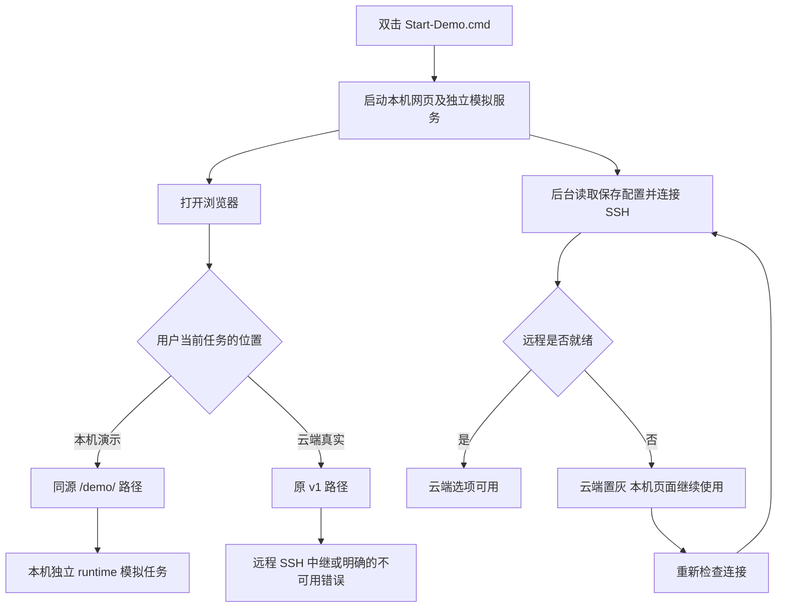

# 服务器离线时继续启动网页

状态：初稿，随功能 PR 评审。日期：2026-11-27。

## 1. 问题与交付行为

原启动器先建立 SSH、等待远程服务就绪，然后才启动本机 HTTP 服务。服务器关闭、连接被重置或认证失败时，Python 连接器退出，Windows 显示 `The connection ended`，网页无法打开。测试阶段仅修改网页也必须先接通 GPU 服务器。

现在双击根目录 `Start-Demo.cmd` 即可先打开本机网页，再后台连接保存的服务器。服务器离线不再阻拦页面使用。

| 场景 | 页面行为 |
|---|---|
| 远程连接中 | “云端处理”置灰，显示“连接中”；本机演示可用 |
| 服务器断开、缺少 SSH、认证或远程启动失败 | 云端置灰并显示“未连接”，网页继续运行 |
| 空工作区且远端未就绪 | 默认选择明确标注的本机演示，可导入与预览视频 |
| 本机已安装 Pillow、FFmpeg 和 FFprobe | 使用现有 CPU 合成片段流程，支持模拟预览与成片 |
| 本机缺少媒体依赖 | 使用基础空 Mock，支持上传、任务和原视频预览，明确提示不生成高光 |
| 远程连接及服务就绪 | 新工作区可选择云端处理；本机演示仍可选择 |
| 恢复已有真实任务但服务器离线 | 报告恢复失败，保留原记录，不用模拟结果替换 |
| 修改已保存的服务器配置 | 点击“重新检查连接”或再次双击入口，后台读取新配置并重连 |

启动仍需要有效 Python 环境、本机可用端口和合法配置。服务器离线不等于本机配置或端口冲突也应忽略。当前服务器仍断开，本次没有恢复云端推理、下载模型或训练模型。

## 2. 启动与请求路径

`scripts/start_demo.py` 复用现有参考后端的 HTTP、上传、任务库、单 worker 和媒体接口；没有复制一套业务实现。`RemoteConnection` 单独管理后台 SSH 进程、连接超时、状态及重连。失败时只回收连接进程，本机服务继续运行。

Windows 启动器改用本机 `/health` 判断网页已启动，远程 `/ready` 不再是打开网页的前置条件。再次启动时复用已有本机服务并触发重连，不重复占用同一端口。

### 接口与数据隔离

- `/api/v1/deployment` 增加可选 `connection` 和 `local_demo` 字段，保留原三字段和旧连接器兼容性。`remote/real` 表示配置目标，不是远程已就绪的证明。
- `POST /api/v1/deployment` 只接受 `{}`，后台读取本机保存配置；浏览器不能提交服务器地址或凭据。连接中不重复启动，已连接则复用。
- 本机模拟使用 `/demo/` 传输前缀；网关去掉前缀后调用原 v1 业务接口。任务、预测、预览和导出请求结构不变。
- `video.src`、Range 请求与下载链接也根据任务执行位置加前缀，避免只修改 fetch 而原生媒体仍请求远端。
- 本机数据在 `runtime/gpu-demo/local/`，远端仍使用原服务器任务库。`mock=true` 始终保留；未加前缀的远程业务请求离线时返回 `503 remote_unavailable`。
- 浏览器记录继续保存 `execution`。恢复按原记录选择位置；已有真实任务不会自动改成本机演示。失败工作区切换位置时清空当前任务及上传引用，历史记录保留，避免跨库复用 upload_id。

连接状态检查在后台连接期间短暂轮询；失败后由操作者点击重连，不持续重试远程服务器。模型就绪同时依据 model 与 ready，不把 SSH 接通当作推理可用。

## 3. 使用与更换服务器

1. 保留现有 Python 环境，双击 `Start-Demo.cmd`。默认网页为 `http://127.0.0.1:18000`。
2. 远程不可用时，选择视频即可预览；点击“体验分析”运行本机模拟。页面上的演示说明用于区分真实分析与测试流程。
3. 后续服务器更换时修改 `config/demo.json` 的主机、端口、部署路径及解释器，并同步本机 OpenSSH 别名。
4. 点击右上角“重新检查连接”。连接完成后，在新的工作区选择云端；历史任务能否恢复仍取决于新服务器是否保留原任务及素材。
5. 若修改的是 `local_port`，先停止原本机启动器再重启。Python 入口需保持终端开启；Windows 后台入口的日志和 PID 在 `runtime/gpu-demo/`。

完整本机媒体模拟需安装 `requirements-dev.txt`，并让 FFmpeg/FFprobe 可在 PATH 找到（也支持 `FFMPEG_BIN` / `FFPROBE_BIN`）。没有这些工具也能打开网页，但空 Mock 不生成片段或成片。

## 4. 验证

### 新增自动回归

`python -m unittest tests.test_startup_offline tests.test_saved_demo`：8 项检查通过，其中 4 项为新增离线启动回归。覆盖后台连接等待时本机 HTTP 可用、缺少 SSH 后本机上传与任务、远程请求拒绝、跨源拒绝、连接超时进程回收、重新连接及再次断开、既有二进制中继和 Range。

`node tests/frontend-offline.cjs`：使用真实临时 Python 网关和明确的空 Mock，验证云端置灰、本机导入、异步任务、刷新恢复、原生视频地址、连接恢复后的模式切换、旧真实任务恢复失败、任务位置隔离及 390px 布局。远程恢复部分只提供就绪元数据夹具，不调用远程模型。视频由浏览器临时生成，截图和日志只留在被忽略的 `runtime/`。

### 已有功能与本机启动

已有 5 组浏览器检查通过：主工作流、播放指针和逐段暂停、失败任务恢复、横竖视频完整预览、单段与多段导出。它们验证界面、请求和下载交互；导出夹具不代表真实成片。

Windows `Start-Demo.ps1 -NoBrowser` 在当前断开的服务器条件下返回退出码 0 与 `Ready: http://127.0.0.1:18000`；本机 health 为 200，deployment 为 unavailable，本机 demo model 可用。仓库完整性检查、Mock 冒烟、JavaScript 语法与补丁空白检查通过。

Windows 扩展组运行了 37 项 Python 检查，其中既有的 `test_bad_requests_upload_limit_and_cors` 在整组中出现 `WinError 10053`，单独运行通过；其余 36 项通过。该测试直接调用本次未修改的参考后端，问题发生在无 filename 的无效上传响应，不将整组记录写为全绿。完整 Linux 检查以 PR 的 CI 结果为准。

本机缺少 FFprobe，本轮未在本机重跑完整 FFmpeg 成片套件；由仓库 CI 的 Linux + FFmpeg 环境执行全量 Python 测试。真实 GPU 流程因服务器离线未复验。验收限于启动解耦、传输隔离和已有网页交互，不扩展模型能力或性能承诺。

## 5. 文件分工

| 文件 | 作用 |
|---|---|
| `Start-Demo.ps1` | 根据本机页面健康状态启动/复用，远程离线不阻拦 |
| `scripts/start_demo.py` | 后台远程连接、本机模拟服务、传输选路与重连 |
| `apps/frontend/app.js` | 连接状态、云端置灰、模式选择、原生媒体与任务恢复选路 |
| `contracts/deployment.schema.json`、`contracts/README.md` | 可选连接状态、控制路由和传输前缀约定 |
| `tests/test_startup_offline.py`、`tests/frontend-offline.cjs` | 离线、重连及位置隔离回归 |
| `tests/test_saved_demo.py` | 既有中继测试使用独立临时 runtime |

提交仅涉及产品与文档，不修改比赛子模块、固定模型引用或服务器资产。回退本次产品提交即可恢复原来等待远程连接的启动行为；不需要迁移服务端业务数据。
