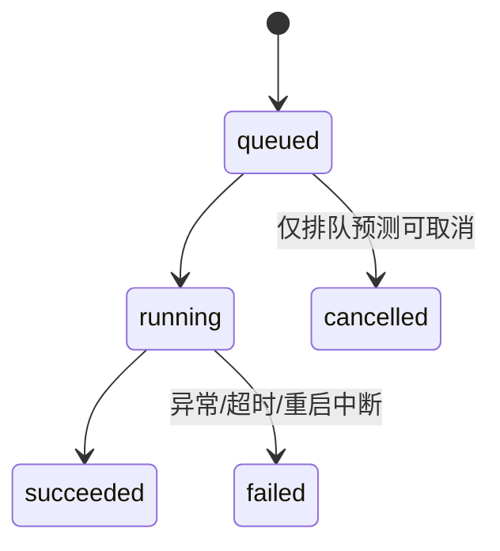
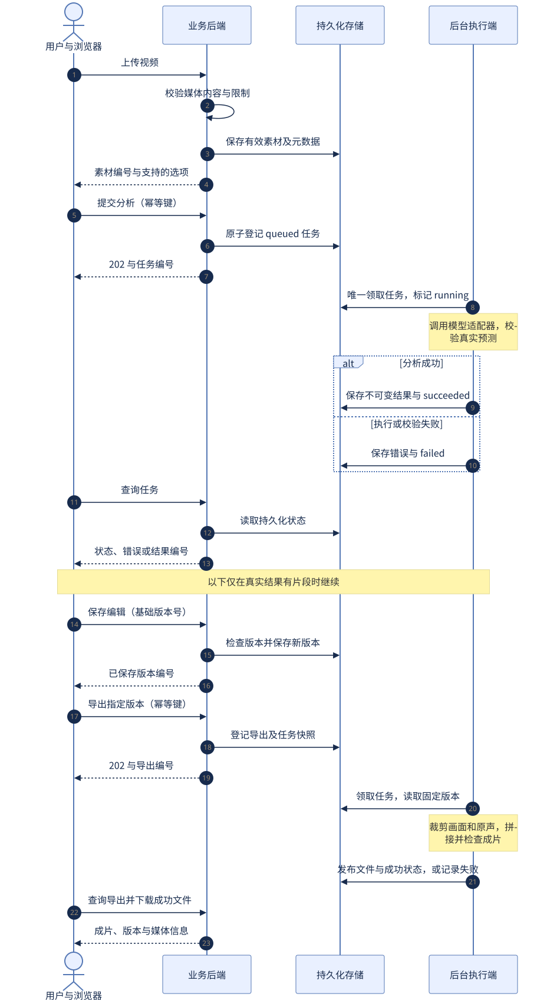

# 03 系统模型与 UML 图（初稿）

[返回需求文档导航](README.md) · [上一篇：功能与交互](02-functional-requirements.md) · [下一篇：数据与接口](04-data-and-interfaces.md)

更新：2026-11-25。下方五张SVG/Mermaid图保留10月27日Project/v2扩展设计，**不是当前v1数据库/路由或本轮必交清单**。本轮保留单机v1与浏览器任务恢复，服务端Project/EditRevision及完整项目删除推迟。实际架构见[架构页](../architecture.md)，实际接口见[04](04-data-and-interfaces.md)。

## 当前v1预测状态

导出单独为queued/running/succeeded/failed，没有用户取消入口。现有v1重试创建新任务/新幂等键，不含retry_of；没有服务端编辑版本。下面图中的“无取消”、retry_of与版本化Project属于旧扩展草案，不应覆盖此现状。扩展图保留为需求来源，不声称已上线。

## 1. 用例与系统边界

[查看可编辑源文件](diagrams/01-use-cases.mmd)

视频使用者完成上传、分析、编辑、导出和项目管理。部署维护者负责配置模型和排除故障，首版不提供维护后台。自部署模型和渲染器由系统调用，用户不直接操作其命令或路径。

连线表示参与关系，不表示时间顺序。模型训练和比赛提交不属于本产品边界。对应 FR-01～FR-14。

## 2. 主要活动流程

[查看可编辑源文件](diagrams/02-workflow.mmd)

分析失败与成功但无高光走不同分支；合法空结果无需伪装成异常。用户取消全部片段时可以保存，但不能生成空成片。导出失败后重用已有方案即可重试，不需重复推理。

图展示一次常规使用；重新分析、恢复原建议和删除项目的详细行为见 FR-03、FR-09、FR-14。对应 AT-01、AT-04、AT-07、AT-10、AT-11、AT-14。

## 3. 分析、编辑与导出的时序

[查看可编辑源文件](diagrams/03-sequence.mmd)

创建任务成功就返回编号，执行端在后台完成工作，浏览器按编号查询。任务必须先持久化再交给执行端；成功结果必须先完整保存再发布成功状态。

“后台执行端”是逻辑角色，可在实现中分为模型进程和渲染进程，不要求建立微服务集群。图中的模型调用经适配层完成。导出读取已保存版本的快照，避免用户继续编辑时改变正在生成的内容。

失败任务的查询请求本身仍可成功；只有导出任务成功且文件有效时才能下载。对应 FR-03、FR-04、FR-09～FR-13。

## 4. 历史v2草案：分析与导出状态机

[查看可编辑源文件](diagrams/04-job-state.mmd)

| 状态 | 进入条件 | 用户可以做什么 |
|---|---|---|
| `queued` | 已创建并保存，等待执行资源 | 查看、离开页面；该历史v2草案未画取消；当前v1排队预测已可取消 |
| `running` | 被唯一执行者领取 | 查看阶段和真实进度，等待 |
| `succeeded` | 结果/成片通过检查并完整发布 | 分析结果可编辑；成片可下载 |
| `failed` | 输入依赖失效、执行异常、超时或恢复时确认中断 | 查看原因，排除后新建重试任务 |

终态不回到 `queued`。重试通过新任务的 `retry_of` 关联旧任务，原失败记录保留。服务恢复时，未开始的队列项在校验依赖后继续排队；遗留执行项须先确认旧进程已结束，再转为失败。

项目存续状态、上传状态、当前草稿是否保存和“无高光”均不混入这个任务枚举。分析任务成功也不自动表示存在成片。对应 BR-08、FR-04、FR-13。

## 5. 核心领域概念类图

[查看可编辑源文件](diagrams/05-domain.mmd)

| 图中关系 | 含义 |
|---|---|
| 项目 → 0..1 源视频 | 新建时尚无素材；成功上传后只能绑定一个 |
| 项目 → 多个任务 | 分析、导出、失败重试都保留独立记录 |
| 源视频 → 多份高光预测 | 再次分析产生新结果，旧结果不被替换 |
| 高光预测 → 多个剪辑版本 | 用户保存修改产生新版本，模型原始建议不变 |
| 剪辑版本 → 多个导出 | 同一方案可重试生成，或使用后续支持的输出配置 |
| 任务 → 分析结果/成片记录 | `kind=analysis` 只产生预测；`kind=export` 关联成片记录 |

`1` 表示每个右侧对象属于一个左侧对象，`0..*` 表示可能没有或存在多个。组合菱形表示项目内资源的归属，不表示可以绕过 FR-14 的任务保护直接级联删除物理文件。

这是一张概念图，省略了工作区、日志、文件存储和模型清单细节；不是完整数据库物理设计。字段与不变量以 [数据字典](04-data-and-interfaces.md) 为准。

## 6. 图与文字如何同步

修改任务状态时，同时更新 FR-04、FR-13、BR-08、状态图和恢复验收；修改帧区间或裁剪规则时，同时更新 FR-05～FR-08、BR-01～BR-06 和媒体验收。仅调整视觉布局无需改变需求编号。

图表维护方式见 [图表说明](diagrams/README.md)。
